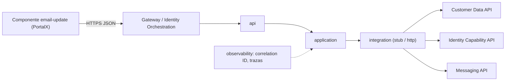
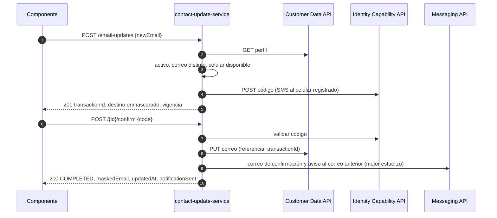
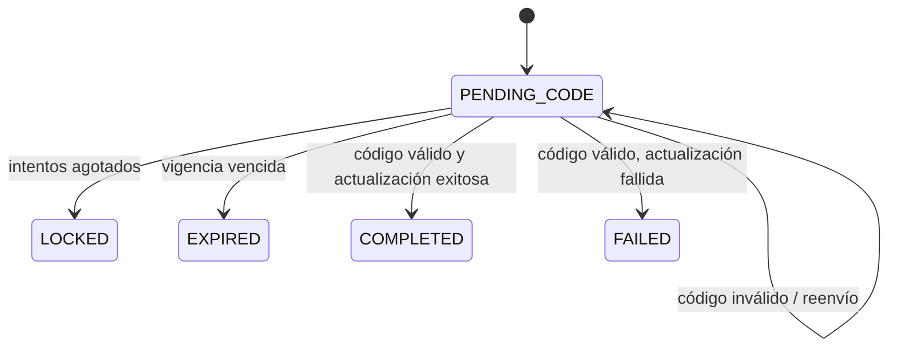

# E2. Diseño técnico

## 1. Decisiones

| ID | Decisión | Alternativa descartada | Justificación |
|---|---|---|---|
| D-01 | Microservicio orquestador nuevo `contact-update-service` | Extender Customer Data Service | Tres capacidades con reglas propias; desacoplado (doc 03); sin regresión sobre un core |
| D-02 | Java 21 y Spring Boot 4.1 (starters webmvc, validation, restclient, test) | Node.js | Consistente con "Microservicios Java" (doc 07) |
| D-03 | Sin librerías adicionales | Lombok, MapStruct, springdoc, Resilience4j, JPA | Records, `ProblemDetail`, logging estructurado nativo y `RetryTemplate` de Spring 7 cubren lo necesario |
| D-04 | Componente web nativo `<email-update>` (módulos ES, sin build) | Framework empaquetado en el portal | Desacoplado y reutilizable (doc 03); sin librerías legadas (doc 02) |
| D-05 | Puertos con adaptadores `stub` (datos sintéticos) y `http` | Solo HTTP con mocks externos | Ejecutable sin las APIs corporativas conservando el manejo real de fallos |
| D-06 | Identidad por cabecera de confianza `X-Affiliate-Id` del gateway | JWT en el servicio | La prueba no incluye el emisor de tokens; evolución a JWT en sección 8 |
| D-07 | Transacciones y trazas en memoria; DDL propuesto | H2 + JPA | Sin infraestructura sin valor para la prueba; aislado en una clase |
| D-08 | Fechas del contrato en ISO-8601 UTC | Formatos del proveedor | Evita diferencias entre navegadores (INC-001) |
| D-09 | La actualización no se reintenta; la confirmación es idempotente por transacción | Reintento con clave de idempotencia | Contrato de idempotencia desconocido (P-08) |
| D-10 | Notificación de mejor esfuerzo: su fallo se traza y se informa, no revierte | Compensar la actualización | El afiliado ya validó identidad y pidió el cambio |

## 2. Componentes



| Paquete | Responsabilidad |
|---|---|
| `api` | Endpoints, Bean Validation, un manejador que traduce errores a `ProblemDetail` |
| `application` | `EmailUpdateService` (inicio, confirmación, reenvío, políticas, idempotencia), `TransactionStore` |
| `domain` | `UpdateTransaction`, `ErrorCode`, `ContactUpdateException`, `Masking` |
| `integration` | Puertos `CustomerDataClient`, `IdentityCapabilityClient`, `MessagingClient`; adaptadores `stub` y `http`; `IntegrationException` con categoría |
| `observability` | `CorrelationIdFilter` (acepta o genera el id, MDC, familia de navegador), `TraceLog` |
| `config` | `AppProperties` validadas al arranque, `HttpIntegrationConfig` |

## 3. Flujos



Reenvío: `POST /{id}/resend` pide un código nuevo si pasó la espera mínima; conserva el contador de intentos; antes de la espera responde 429 con `Retry-After`.

## 4. Estados



Los estados distintos de `PENDING_CODE` son terminales. Confirmar una `COMPLETED` responde 409 `ALREADY_COMPLETED` con el resultado final, para que la interfaz muestre el éxito si el afiliado reintenta.

## 5. Contrato del microservicio

Cabeceras: `X-Affiliate-Id` (obligatoria, la inyecta el gateway; `[A-Za-z0-9-]{1,64}`) y `X-Correlation-Id` (opcional; se genera si falta; siempre se devuelve y se propaga).

`POST /api/v1/contact/email-updates` con `{ "newEmail": "ana.nueva@example.com" }` responde 201:

```json
{ "transactionId": "6f1c...", "status": "PENDING_CODE", "channel": "SMS", "maskedDestination": "***4567",
  "expiresInSeconds": 300, "resendAvailableInSeconds": 60, "attemptsAllowed": 3 }
```

`POST /api/v1/contact/email-updates/{id}/confirm` con `{ "code": "123456" }` responde 200:

```json
{ "transactionId": "6f1c...", "status": "COMPLETED", "maskedEmail": "a***@example.com",
  "updatedAt": "2026-10-24T15:05:33Z", "notificationSent": true }
```

`POST /api/v1/contact/email-updates/{id}/resend` sin cuerpo responde 200 con la forma del inicio.

Errores en `application/problem+json` (RFC 9457) con `code`, `correlationId` y propiedades extra:

| `code` | HTTP | Cuándo | Extra |
|---|---|---|---|
| `VALIDATION_ERROR` | 400 | DTO o cabecera inválidos; JSON malformado | `errors[]` |
| `UNAUTHENTICATED` | 401 | Falta `X-Affiliate-Id` | |
| `AFFILIATE_NOT_FOUND` | 404 | Afiliado desconocido | |
| `TRANSACTION_NOT_FOUND` | 404 | Id inexistente o de otro afiliado | |
| `ALREADY_COMPLETED` | 409 | Ya completada | `result` |
| `TRANSACTION_FAILED` | 409 | Falló en un intento previo; iniciar de nuevo | |
| `CODE_EXPIRED` | 410 | Vigencia vencida | |
| `AFFILIATE_NOT_ELIGIBLE` | 422 | Afiliado inactivo | |
| `IDENTITY_CHANNEL_UNAVAILABLE` | 422 | Sin celular registrado | |
| `INVALID_CODE` | 422 | Código incorrecto | `remainingAttempts` |
| `MAX_ATTEMPTS_EXCEEDED` | 423 | Intentos agotados | |
| `RESEND_TOO_SOON` | 429 | Reenvío antes de la espera | `retryAfterSeconds`, `Retry-After` |
| `INTERNAL_ERROR` | 500 | Error no previsto | |
| `PROVIDER_UNAVAILABLE` | 503 | Proveedor caído o 5xx | `provider`, `Retry-After` |
| `PROVIDER_TIMEOUT` | 504 | Proveedor lento | `provider`, `Retry-After` |

Los mensajes (`detail`) van en español, dirigidos al afiliado y sin detalles internos.

## 6. Contratos asumidos de las APIs corporativas (Supuesto S5)

| API | Operación | Petición | Respuesta |
|---|---|---|---|
| Customer Data | `GET /affiliates/{id}/profile` | `X-Api-Key`, `X-Correlation-Id` | `{ affiliateId, email, mobile, status }`; 404 si no existe |
| Customer Data | `PUT /affiliates/{id}/contact/email` | `{ email, validationReference }` | `{ updatedAt }` |
| Identity Capability | `POST /verification-codes` | `{ affiliateId, channel: "SMS", destination }` | `{ challengeId }` |
| Identity Capability | `POST /verification-codes/{challengeId}/validate` | `{ code }` | `{ valid }` |
| Messaging | `POST /messages/email` | `{ to, template, params }` | 202 |

Mapeo de fallos: timeout de conexión o lectura es `TIMEOUT` (504); conexión rechazada o 5xx es `UNAVAILABLE` (503); 4xx no esperado es `REJECTED` (503, contrato roto).

## 7. Manejo de errores

- Una excepción de negocio (`ContactUpdateException` con `ErrorCode`) y una técnica (`IntegrationException` con proveedor y categoría); un único `@RestControllerAdvice`. Nada se silencia.
- Timeouts configurables: conexión 2 s, lectura 5 s (doc 04, INC-002).
- Reintento acotado solo en la lectura del perfil (idempotente); nunca en la actualización ni en la validación del código.
- Si el código es válido y la actualización falla, la transacción pasa a `FAILED`: no queda un reto consumido en estado pendiente.
- Notificación fallida: `notificationSent=false` y traza `NOTIFICATION_FAILED`.

## 8. Seguridad (doc 08)

| Riesgo | Control |
|---|---|
| A01 Control de acceso (IDOR) | Afiliado desde la cabecera del gateway; pertenencia de la transacción; id ajeno responde 404 |
| A02 Criptografía | TLS en gateway e IntegrationHub; el servicio nunca almacena ni registra el código; secretos por variables de ambiente |
| A03 Inyección | Bean Validation en DTOs y cabeceras; JSON tipado |
| A04 Diseño inseguro | Vigencia 5 min, 3 intentos, espera de reenvío 60 s, bloqueo; el reenvío no reinicia intentos |
| A05 Configuración | Propiedades validadas al arranque; stubs solo en perfiles `local` y `test` |
| A07 Autenticación | Comparación en tiempo constante en el stub; el proveedor real valida el código |
| A09 Registro | Logs estructurados con correlationId; eventos `CODE_REJECTED`, `LOCKED`, `CONTACT_UPDATED`; datos enmascarados |
| A10 SSRF | URLs solo desde configuración |
| Biometría | Fuera de alcance; la traza conserva identificadores, resultado, proveedor y fecha |

Evolución: validar el JWT de sesión con `spring-boot-starter-oauth2-resource-server` y tomar el afiliado del claim `sub`. Antes de producción: formato de evaluación de ciberseguridad y escaneo de código (3 días hábiles).

## 9. Trazabilidad y observabilidad

`CorrelationIdFilter` acepta o genera `X-Correlation-Id`, lo pone en MDC junto con la familia de navegador (indicador "errores por navegador", doc 11) y registra la latencia de cada petición. `TraceLog` guarda un evento por paso y lo escribe como log estructurado (formato ECS nativo de Spring Boot).

| Evento | Resultado | Cuándo |
|---|---|---|
| `STARTED` | OK | Transacción creada y código enviado |
| `CODE_RESENT` | OK | Reenvío aceptado |
| `CODE_REJECTED` | FAIL | Código inválido (intentos restantes) |
| `LOCKED` | FAIL | Intentos agotados |
| `EXPIRED` | FAIL | Vigencia vencida |
| `CONTACT_UPDATED` | OK | Correo actualizado |
| `UPDATE_FAILED` | FAIL | Actualización fallida tras validar |
| `NOTIFICATION_SENT` / `NOTIFICATION_FAILED` | OK / FAIL | Notificación |
| `PROVIDER_ERROR` | FAIL | Timeout o indisponibilidad |

Campos: `occurredAt`, `transactionId`, `correlationId`, `affiliateId`, `event`, `result`, `provider`, `detail` (enmascarado), `browser`. Nunca código ni datos de contacto en claro.

Persistencia propuesta (P-10):

```sql
CREATE TABLE contact_update_trace (
  id             BIGINT GENERATED ALWAYS AS IDENTITY PRIMARY KEY,
  occurred_at    TIMESTAMP WITH TIME ZONE NOT NULL,
  transaction_id VARCHAR(36)  NOT NULL,
  correlation_id VARCHAR(64)  NOT NULL,
  affiliate_id   VARCHAR(64)  NOT NULL,
  event          VARCHAR(32)  NOT NULL,
  result         VARCHAR(8)   NOT NULL,
  provider       VARCHAR(16),
  detail         VARCHAR(255),
  browser        VARCHAR(16)
);
CREATE INDEX ix_trace_transaction ON contact_update_trace (transaction_id);
CREATE INDEX ix_trace_correlation ON contact_update_trace (correlation_id);
```

Indicadores derivables (doc 11, doc 14): tasa de éxito, tiempo de validación, abandono, errores por navegador, disponibilidad del proveedor, latencia.

## 10. Datos sintéticos (stubs)

| Entrada | Comportamiento |
|---|---|
| `AFF-001` | Activo, correo `ana.perez@example.com`, celular `3001234567` |
| `AFF-002` | Sin celular: `IDENTITY_CHANNEL_UNAVAILABLE` |
| `AFF-003` | Inactivo: `AFFILIATE_NOT_ELIGIBLE` |
| `AFF-004` | Sin correo previo: sin aviso al correo anterior |
| `AFF-IDP-TIMEOUT` / `AFF-IDP-DOWN` | Proveedor de identidad lento / caído |
| `AFF-CDS-DOWN` | Customer Data falla al actualizar: transacción `FAILED` |
| Correo `@down.test` | Messaging falla: `notificationSent=false` |
| Código `123456` | Único código válido (configurable) |

## 11. Variables de ambiente

| Variable | Por defecto | Descripción |
|---|---|---|
| `PORT` | `8080` | Puerto HTTP |
| `SPRING_PROFILES_ACTIVE` | vacío | `local`: stubs, logs legibles, demo del frontend |
| `INTEGRATION_MODE` | `http` | `http` o `stub` |
| `CUSTOMER_DATA_BASE_URL`, `IDENTITY_BASE_URL`, `MESSAGING_BASE_URL` | vacío | Obligatorias en modo `http` (fail-fast) |
| `CUSTOMER_DATA_API_KEY`, `IDENTITY_API_KEY`, `MESSAGING_API_KEY` | vacío | Credenciales |
| `INTEGRATION_CONNECT_TIMEOUT` / `INTEGRATION_READ_TIMEOUT` | `PT2S` / `PT5S` | Timeouts |
| `VERIFICATION_CODE_TTL` / `VERIFICATION_MAX_ATTEMPTS` / `VERIFICATION_RESEND_COOLDOWN` | `PT5M` / `3` / `PT60S` | Política del código |
| `STUB_VERIFICATION_CODE` | `123456` | Código del stub |
| `FRONTEND_DIR` | `../frontend/src` | Carpeta servida en `local` |

## 12. Componente frontend

- `<email-update api-base="/api/v1" affiliate-id="...">`; el atributo identifica, no autentica (el gateway inyecta la cabecera real).
- Vistas: correo nuevo, código (destino enmascarado, cuenta regresiva, reenviar) y confirmación. Errores con el `detail` del `ProblemDetail` y acción sugerida.
- Estado en una función pura `transition(state, event)`; cliente HTTP con `AbortSignal.timeout`, `X-Correlation-Id` por petición y mapeo a `ApiError`; validación de correo y código.
- Compatibilidad: Safari 16.4+, Chrome y Edge. Vetadas por soporte insuficiente en Safari: `requestIdleCallback`, `Object.groupBy`, `Promise.withResolvers`, `Promise.try`, iterator helpers, `Error.captureStackTrace`, `URL.parse`. Toda API opcional se usa con detección de capacidad.
- Emite `email-update:completed` para los indicadores del portal (doc 11). Accesibilidad: etiquetas, `aria-live`, foco al cambiar de vista, `autocomplete="one-time-code"`.

## 13. Plantilla de diseño técnico (enunciado, sección 8)

| Campo | Respuesta |
|---|---|
| Componente frontend | `<email-update>` nativo, tres vistas, estado puro, cliente HTTP con timeout y correlationId; Safari 16.4+, Chrome y Edge |
| Servicio/API | `contact-update-service`: `POST /email-updates`, `POST /{id}/confirm`, `POST /{id}/resend`; consume Customer Data, Identity Capability y Messaging |
| Validaciones | Frontend: formato de correo y código. Backend: Bean Validation, afiliado activo, correo distinto, canal disponible, transacción propia y vigente, código con intentos y expiración |
| Manejo de errores | 15 códigos sobre `ProblemDetail`; categorías TIMEOUT / UNAVAILABLE / REJECTED; timeouts; reintento solo en lecturas; estados terminales |
| Datos sintéticos | `AFF-001` a `AFF-004`, `AFF-IDP-TIMEOUT`, `AFF-IDP-DOWN`, `AFF-CDS-DOWN`, dominio `down.test`, código `123456` |
| Logs/correlationId | Id aceptado o generado, en MDC, respuesta y llamadas salientes; logs ECS; familia de navegador; diez eventos de traza enmascarados |
| Pruebas | Unitarias, API con MockMvc, adaptadores con MockRestServiceServer, negativas por código, indisponibilidad de externos, WebKit y Chromium |
| README/PR | README con instalación, variables, ejecución y pruebas; PR con checklist de pruebas, variables, ciberseguridad y despliegue |

## 14. Extensiones previstas

| Extensión | Punto de inserción |
|---|---|
| Verificar propiedad del correo nuevo (P-03) | Estado `PENDING_EMAIL_OWNERSHIP` reutilizando `IdentityCapabilityClient` con canal correo |
| Actualizar celular | Mismo servicio con `newMobile`; validación por correo registrado o facial |
| Validación facial | Puerto `FacialValidationClient`; sin almacenar imágenes |
| JWT en el servicio | Resource server; claim `sub` reemplaza la cabecera |
| Persistencia | `TransactionStore` y `TraceLog` sobre la base del canal (DDL de la sección 9) |
| Circuit breaker por proveedor | Resilience4j si INC-005 es recurrente |
